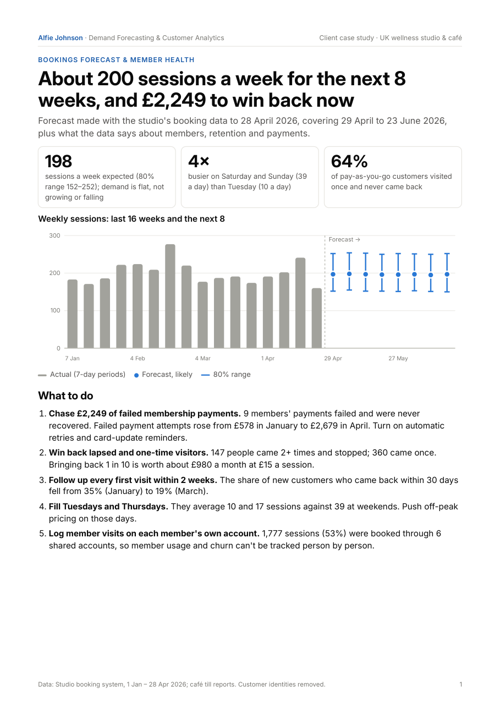
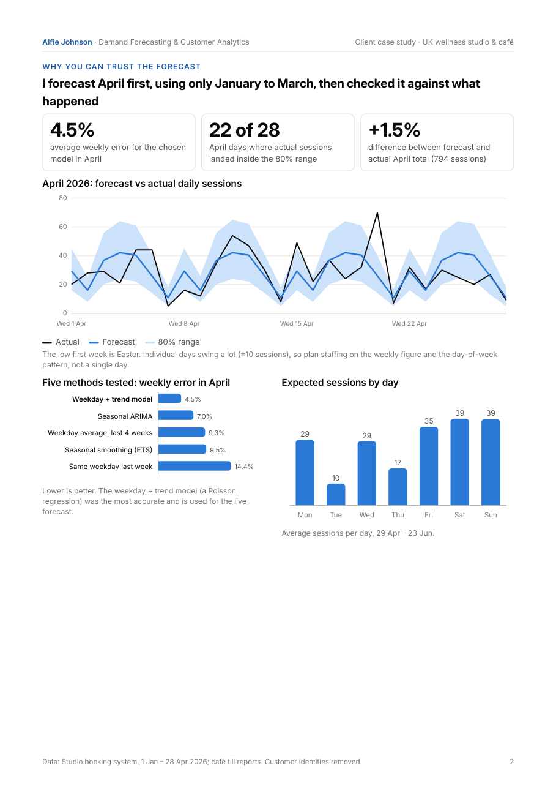
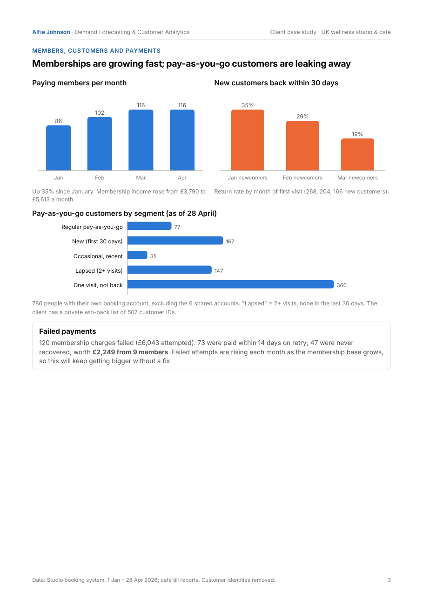

# Bookings Forecast & Member Health: Wellness Studio and Café

**How many sessions will we book over the next 8 weeks, when are we busiest, and where are we losing money and customers?**

A client project for a UK contrast-therapy studio and café. Four months of booking data (January–April 2026) were turned into an 8-week forecast with a range for staffing, a weekly tracker, and a short list of actions. Before trusting the forecast, five methods were tested on a month they never saw.

## Results

| | |
| --- | --- |
| Forecast, 29 Apr – 23 Jun 2026 | **~200 sessions a week** (80% range about 150–250) |
| 8-week total | 1,595 likely (80% range 1,457–1,744) |
| Trend | Flat (−1.6% per 100 days) |
| Busiest vs quietest day | Saturday and Sunday (~39 a day) vs Tuesday (~10 a day) |
| Failed membership payments never recovered | **£2,249 from 9 members** (Jan–Apr) |
| Pay-as-you-go customers who visited once | 64% |
| New customers back within 30 days | 35% (Jan) → 29% (Feb) → 19% (Mar) |

**Why trust it:** April was forecast using only January–March data, then compared with what actually happened.

| Method (April backtest) | Weekly error | April total error |
| --- | --- | --- |
| **Weekday + trend model (Poisson regression)** | **4.5%** | **+1.5%** |
| Seasonal ARIMA | 7.0% | −1.3% |
| Weekday average, last 4 weeks | 9.3% | −8.2% |
| Seasonal smoothing (ETS) | 9.5% | −6.9% |
| Same weekday last week | 14.4% | −12.3% |

22 of 28 April days landed inside the 80% range. The live forecast uses the Poisson model, with 5,000 simulated futures (negative binomial noise plus a weekly shock) giving the likely figure and range.

## Recommendations from the pack

1. Chase unrecovered failed payments and turn on automatic retries and card-update reminders.
2. Win back lapsed and one-visit customers: bringing back 1 in 10 is worth about £980 a month.
3. Follow up every first visit within 2 weeks, as the 30-day return rate is falling.
4. Fill Tuesdays and Thursdays with off-peak pricing.
5. Log member visits on members' own accounts, so usage and churn can be tracked per person.

## What's in this repo

| Path | What it is |
| --- | --- |
| `reports/bookings_forecast_pack.pdf` | The 4-page client-style pack: forecast and actions, backtest, members and payments, staffing and café |
| `tracker/sessions_tracker.xlsx` | Weekly tracker: enter actual sessions, get On track / Busier / Quieter flags; daily rota view; April check; failed-payments log |
| `notebooks/forecasting_wellness_bookings.ipynb` | Full analysis: data prep, demand patterns, Poisson model and simulation, 5-method backtest, forecast, payments, customer segments, cohorts, café |
| `data/README.md` | Data description (data not included) |

## Privacy

The data is a real client's and is **not included**. Before analysis, the booking export was pseudonymised on the client's machine: every customer became an ID (`M-0001`, …) and names, emails, staff names and payment IDs were removed (GDPR). Service and product names are de-branded. The notebook shows aggregated outputs only.

## How to run

1. `pip install -r requirements.txt`
2. Place data files with the structure described in `data/README.md` in `data/`.
3. Open `notebooks/forecasting_wellness_bookings.ipynb` and run all cells.

## Tools

Python · pandas · NumPy · statsmodels (GLM, ETS, SARIMAX) · matplotlib · Excel

## Author

Alfie Johnson: demand forecasting and customer analytics for ecommerce, retail and hospitality businesses. Available on Upwork.
